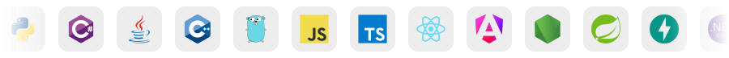
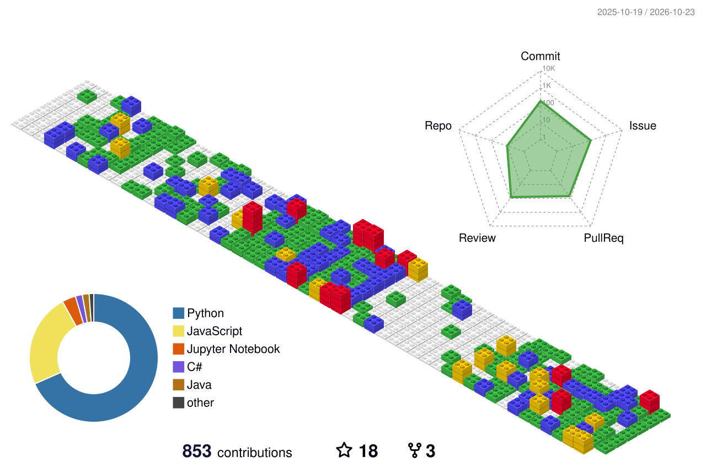

<div align="center">
  
### 👋 Welcome to My Page 👋
  
  
<div align="center">
  
<!-- Animated typing effect -->
<a href="https://git.io/typing-svg"></a>

<p align="center">
  
</p>
  
</div>


</div>

<p align="center"></p>

<div align="left">
  
### 🎯 About Me
  
- 🏫 I graduated from [Hanoi University of Science and Technology](https://hust.edu.vn/), majoring in Electronics and Telecommunications Engineering, my works in the undergraduate program mainly focus on AI solution for anomaly detection and speech processing for agriculture domain
- 🏢 Recently, I had over 1 year experience as a Backend Developer.
- 🌱 Currently, I am embarking on the Master Program of Information Technology at [The University of Western Australia](https://www.uwa.edu.au/), a top 100 university in [QS Ranking](https://www.topuniversities.com/universities/university-western-australia), with the specialization in Artificial Intelligence. 
- 🎖️ My main techstack focuses on C#, SQl Server and Python for Backend and AI development, but I can also work minorly with Angular, NodeJS for web development and Spark, AWS Service for data pipeline maintenance
- 📅 For the time being, I have shifted my career path to Data Engineering, NLP, LLM and further Mlops development.
- 🚵 I am seeking for a chance to horn my practical skills through project, open source contribution or non-profit technological project, which will act as a precursor to make an advancement in my career as a Software Engineer with the focus on Data and AI engineering.
  
</div>

<p align="center"></p>

<div align="left">

### 🚀 Featured Projects

| Project | Tech stack | Impact |
| --- | --- | --- |
| **🌐 [Martin Portfolio](https://github.com/husthunterpy01/Martin-Portfolio)**<br>Personal portfolio site built with React and deployed on GitHub Pages.<br>[Live site](https://husthunterpy01.github.io/Martin-Portfolio/) |       | • 🌍 Live and publicly accessible<br>• 📬 EmailJS integration so visitors can message me without a custom backend<br>• 🔄 A `sync:github` script pulls project data from my GitHub repositories<br>• 🚀 One-command deployment (`npm run deploy`) |
| **🚗 [Autonomous Vehicle Job Profiles](https://github.com/husthunterpy01/Autonomous_Vehicle_Job_Profiles_Group3)**<br>CITS5206 Capstone (UWA). Scrapes AV job ads, classifies them with an LLM, and serves a job board plus skill-trend dashboard. I built the data pipeline and deployment. |               | • 🔎 One searchable place for AV jobs, with salary and country filters<br>• 📈 Skill demand tracked over time on a Market Trends page<br>• 🧠 LLM classification finds AV roles, including adjacent ones that never say "autonomous"<br>• 🗄️ Bronze → silver → gold pipeline; every job links to its original posting<br>• ✅ Tests and lint run in CI on every pull request; accessibility audit (WCAG 2.1 AA) and data-quality check done |
| **💬 [Dialog Summarization System](https://github.com/husthunterpy01/Dialog-Summarization-System)**<br>RAG customer-service chatbot that summarizes the conversation with a fine-tuned BART model and reuses the latest summary as context.<br>[Demo video](https://www.youtube.com/watch?v=-LUDuQUJZ8c) |          | • ⚡ Summary as context cuts input tokens and speeds up responses, with a built-in time and token comparison<br>• 🎯 Hybrid search (vector + keyword) and semantic chunking improve retrieval<br>• 🧪 Pre-trained on SAMSum, fine-tuned on TweetSumm, tracked with ROUGE and W&B<br>• 📦 Fine-tuned checkpoint [published on Hugging Face](https://huggingface.co/husthunterpy01/BART-SamTweetSUM); runs on CPU with a small quantised model |
| **🦢 [SwanFlip Marketplace](https://github.com/husthunterpy01/SwanFlip-Marketplace)**<br>CITS5505 (UWA), team of three. Peer-to-peer marketplace for UWA students to buy, sell or trade textbooks, gear and furniture on campus. |               | • 🎓 Local, trusted place for students to trade, lowering study costs and keeping usable items out of landfill<br>• 💬 Real-time chat and notifications over WebSockets<br>• 📍 Location-aware listings via the Geoapify API<br>• 🏗️ Service-layer structure with migrations and seed data<br>• 🧪 Unit tests plus Selenium end-to-end tests with their own live server and test database |

</div>

<p align="center"></p>

<div align="left">
  
### 💻 Tech Stack

<p align="center">
  
</p>
  
<h3 align="left">Programming languages:</h3>
<p align="left">
  <a href="https://learn.microsoft.com/en-us/dotnet/csharp/" target="_blank" rel="noreferrer">
    
  </a>
  <a href="https://www.python.org/" target="_blank" rel="noreferrer">
    
  </a>
  <a href="https://www.java.com/" target="_blank" rel="noreferrer">
    
  </a>
  <a href="https://www.w3schools.com/cpp/" target="_blank" rel="noreferrer">
    
  </a>
  <a href="https://golang.org/" target="_blank" rel="noreferrer">
    
  </a>
  <a href="https://developer.mozilla.org/en-US/docs/Web/JavaScript" target="_blank" rel="noreferrer">
    
  </a>
  <a href="https://www.typescriptlang.org/" target="_blank" rel="noreferrer">
    
  </a>
</p>

<h3 align="left">Machine Learning/ Deep Learning:</h3>
<p align="left">
  <a href="https://pytorch.org/" target="_blank" rel="noreferrer">
    
  </a>
  <a href="https://scikit-learn.org/" target="_blank" rel="noreferrer">
    
  </a>
  <a href="https://seaborn.pydata.org/" target="_blank" rel="noreferrer">
    
  </a>
  <a href="https://www.tensorflow.org" target="_blank" rel="noreferrer">
    
  </a>
  <a href="https://pandas.pydata.org/" target="_blank" rel="noreferrer">
    
  </a>
  <a href="https://numpy.org/" target="_blank" rel="noreferrer">
    
  </a>
  <a href="https://huggingface.co/" target="_blank" rel="noreferrer">
    
  </a>
  <a href="https://jupyter.org/" target="_blank" rel="noreferrer">
    
  </a>
</p>

<h3 align="left">Big data development:</h3>
<p align="left">
  <a href="https://aws.amazon.com" target="_blank" rel="noreferrer">
    
  </a>
  <a href="https://azure.microsoft.com/en-in/" target="_blank" rel="noreferrer">
    
  </a>
  <a href="https://cassandra.apache.org/" target="_blank" rel="noreferrer">
    
  </a>
  <a href="https://www.docker.com/" target="_blank" rel="noreferrer">
    
  </a>
  <a href="https://cloud.google.com" target="_blank" rel="noreferrer">
    
  </a>
  <a href="https://hive.apache.org/" target="_blank" rel="noreferrer">
    
  </a>
  <a href="https://kubernetes.io" target="_blank" rel="noreferrer">
    
  </a>
  <a href="https://spark.apache.org/" target="_blank" rel="noreferrer">
    
  </a>
  <a href="https://www.databricks.com/" target="_blank" rel="noreferrer">
    
  </a>
  <a href="https://www.getdbt.com/" target="_blank" rel="noreferrer">
    
  </a>
</p>

<h3 align="left">Web development</h3>
<p align="left">
  <a href="https://angular.io" target="_blank" rel="noreferrer">
    
  </a>
  <a href="https://getbootstrap.com" target="_blank" rel="noreferrer">
    
  </a>
  <a href="https://www.w3schools.com/css/" target="_blank" rel="noreferrer">
    
  </a>
  <a href="https://dotnet.microsoft.com/" target="_blank" rel="noreferrer">
    
  </a>
  <a href="https://git-scm.com/" target="_blank" rel="noreferrer">
    
  </a>
  <a href="https://graphql.org" target="_blank" rel="noreferrer">
    
  </a>
  <a href="https://www.w3.org/html/" target="_blank" rel="noreferrer">
    
  </a>
  <a href="https://www.linux.org/" target="_blank" rel="noreferrer">
    
  </a>
  <a href="https://postman.com" target="_blank" rel="noreferrer">
    
  </a>
  <a href="https://spring.io/" target="_blank" rel="noreferrer">
    
  </a>
  <a href="https://react.dev/" target="_blank" rel="noreferrer">
    
  </a>
  <a href="https://nextjs.org/" target="_blank" rel="noreferrer">
    
  </a>
  <a href="https://tailwindcss.com/" target="_blank" rel="noreferrer">
    
  </a>
  <a href="https://nodejs.org/" target="_blank" rel="noreferrer">
    
  </a>
  <a href="https://fastapi.tiangolo.com/" target="_blank" rel="noreferrer">
    
  </a>
  <a href="https://flask.palletsprojects.com/" target="_blank" rel="noreferrer">
    
  </a>
  <a href="https://streamlit.io/" target="_blank" rel="noreferrer">
    
  </a>
</p>

<h3 align="left">Databases</h3>
<p align="left">
  <a href="https://www.microsoft.com/en-us/sql-server" target="_blank" rel="noreferrer">
    
  </a>
  <a href="https://www.mysql.com/" target="_blank" rel="noreferrer">
    
  </a>
  <a href="https://www.postgresql.org/" target="_blank" rel="noreferrer">
    
  </a>
  <a href="https://www.mongodb.com/" target="_blank" rel="noreferrer">
    
  </a>
  <a href="https://www.sqlite.org/" target="_blank" rel="noreferrer">
    
  </a>
  <a href="https://neo4j.com/" target="_blank" rel="noreferrer">
    
  </a>
  <a href="https://supabase.com/" target="_blank" rel="noreferrer">
    
  </a>
</p>

<h3 align="left">Testing, DevOps &amp; Deployment</h3>
<p align="left">
  <a href="https://github.com/features/actions" target="_blank" rel="noreferrer">
    
  </a>
  <a href="https://pytest.org/" target="_blank" rel="noreferrer">
    
  </a>
  <a href="https://www.selenium.dev/" target="_blank" rel="noreferrer">
    
  </a>
  <a href="https://playwright.dev/" target="_blank" rel="noreferrer">
    
  </a>
  <a href="https://vercel.com/" target="_blank" rel="noreferrer">
    
  </a>
</p>

</div>

<p align="center"></p>

<div align="left">
  
### 📊 GitHub Stats
  
<p align="center">
  <a href="https://github.com/husthunterpy01?tab=repositories">
    
  </a>
  <a href="https://github.com/husthunterpy01?tab=stars">
    
  </a>
</p>


</div>

<p align="center"></p>

<div align="left">

### ⏰ When I Code

<!-- Auto-generated by th3c0d3br34ker/github-readme-info (see .github/workflows/readme-info.yml) -->
<!--START_CONTRIBUTIONS:readme-info-->
**🏆 784 Contributions in year 2026**


<!--END_CONTRIBUTIONS:readme-info-->

<!--START_SECTION_LINES_OF_CODE:readme-info-->
**From Hello World I have written 11.2 million Lines of Code ✍️**


<!--END_SECTION_LINES_OF_CODE:readme-info-->

<!--START_SECTION_DAILY_COMMIT:readme-info-->
**I'm an early 🐤** 

| | | | |
| --- | --- | --- | --- |
|🌞 Morning                |93 commits          |████░░░░░░░░░░░░░░░░|19.87%|
|🌆 Daytime                |172 commits         |███████░░░░░░░░░░░░░|36.75%|
|🌃 Evening                |160 commits         |███████░░░░░░░░░░░░░|34.19%|
|🌙 Night                  |43 commits          |██░░░░░░░░░░░░░░░░░░|9.19%|
| | | | |

<!--END_SECTION_DAILY_COMMIT:readme-info-->

<!--START_SECTION_WEEKLY_COMMIT:readme-info-->
📅 **I'm Most Productive on Saturdays** 

| | | | |
| --- | --- | --- | --- |
|Monday                   |62 commits          |███░░░░░░░░░░░░░░░░░|14.35%|
|Tuesday                  |43 commits          |██░░░░░░░░░░░░░░░░░░|9.95%|
|Wednesday                |44 commits          |██░░░░░░░░░░░░░░░░░░|10.19%|
|Thursday                 |80 commits          |████░░░░░░░░░░░░░░░░|18.52%|
|Friday                   |48 commits          |██░░░░░░░░░░░░░░░░░░|11.11%|
|Saturday                 |83 commits          |████░░░░░░░░░░░░░░░░|19.21%|
|Sunday                   |72 commits          |███░░░░░░░░░░░░░░░░░|16.67%|
| | | | |

<!--END_SECTION_WEEKLY_COMMIT:readme-info-->

### 🗂️ Top 5 Languages

<!--START_SECTION_LANGUAGE:readme-info-->
```text
My 💖 top 5 languages (by number of repos)

Jupyter Notebo 13 repos  ███████░░░░░░░░░░░░░   34.21%
Python         11 repos  ██████░░░░░░░░░░░░░░   28.95%
C#              3 repos  ██░░░░░░░░░░░░░░░░░░    7.89%
Java            2 repos  █░░░░░░░░░░░░░░░░░░░    5.26%
C               2 repos  █░░░░░░░░░░░░░░░░░░░    5.26%
```

<!--END_SECTION_LANGUAGE:readme-info-->


</div>

<p align="center"></p>

<div align="left">
  
### 🏔️ Most Used Languages
  


</div>

<p align="center"></p>


<div align="left">
  
### ✍️ Random Dev Quote
  


</div>

<p align="center"></p>

<div align="left">
  
### 📫 How to Reach Me
  
For future collaboration and career discussion, you can contact me at:
  
[](https://www.linkedin.com/in/minh-dang-tran-nhat-jonathan-dang-a19420251/) 
[](mailto:fantasy2841@gmail.com)
  
<!-- Animated footer -->
<!--  -->

</div>

<!-- Additional animated elements -->
<div align="center">
  


</div>
