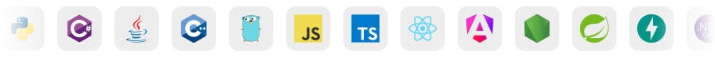

### 👋 Welcome to My Page 👋

<!-- Animated typing effect -->

  

### 🎯 About Me

- 🎯 I build the platform layer under AI: data pipelines, model serving, observability and distributed storage, so ML and LLM systems run reliably in production.
- 🏫 Master of Information Technology (AI) at [The University of Western Australia](https://www.uwa.edu.au/), a top 100 university in [QS Ranking](https://www.topuniversities.com/universities/university-western-australia). B.Eng. in Electronics and Telecommunications at [Hanoi University of Science and Technology](https://hust.edu.vn/), where my undergraduate work covered AI for anomaly detection and speech processing in agriculture.
- 🏢 1+ year as a Backend Developer (C#, SQL Server, Python), now focused on distributed systems, data engineering and MLOps.
- 🔭 Currently building: an LSM-tree compaction engine in Go (seqcomp), a speech-to-text MLOps platform, and a RAG system deployed with Docker and Ansible.
- 🤝 Looking for AI/ML platform, data infrastructure or MLOps roles, and open-source or non-profit work in distributed systems.

### 🚀 Featured Projects

| Project | Tech stack | Impact |
| --- | --- | --- |
| **🧱 [seqcomp](https://github.com/husthunterpy01/seqcomp)** <!-- TODO: confirm repo link -->** LSM-tree compaction engine in Go, built to explore storage-engine trade-offs for ML/data workloads. |    | • 🗜️ Compaction strategies implemented and compared • 📉 TODO: write amplification / throughput numbers • 📐 TODO: link architecture diagram and design write-up |
| **🎙️ [Speech-to-Text MLOps Platform](https://github.com/husthunterpy01/TODO)** End-to-end STT platform: ingestion, medallion data layers, model serving, observability and LLM KV caching. |     | • 🥉🥈🥇 Bronze → silver → gold data layers • 📊 TODO: metrics / dashboards for latency and drift • ⚡ TODO: KV-caching latency or cost result |
| **🕸️ [ContextMesh](https://github.com/husthunterpy01/TODO)** RAG system architecture with containerised deployment (Docker + Ansible) on Cloudflare. |     | • 🏗️ Reproducible, automated deployment • 🔎 Retrieval layer designed as separate, scalable services • 📐 TODO: link architecture diagram |
| **🚗 [Autonomous Vehicle Job Profiles](https://github.com/husthunterpy01/Autonomous_Vehicle_Job_Profiles_Group3)** CITS5206 Capstone (UWA). Scrapes AV job ads, classifies them with an LLM, and serves a job board plus skill-trend dashboard. I built the data pipeline and deployment. |           | • 🗄️ Bronze → silver → gold pipeline; every job links to its original posting • 🧠 LLM classification finds AV roles, including adjacent ones that never say "autonomous" • ✅ Tests and lint run in CI on every pull request; WCAG 2.1 AA accessibility audit and data-quality check done • 📈 Skill demand tracked over time on a Market Trends page |
| **💬 [Dialog Summarization System](https://github.com/husthunterpy01/Dialog-Summarization-System)** RAG customer-service chatbot that summarizes the conversation with a fine-tuned BART model and reuses the latest summary as context. [Demo video](https://www.youtube.com/watch?v=-LUDuQUJZ8c) |        | • ⚡ Summary-as-context cuts input tokens and speeds up responses, with a built-in time and token comparison • 🎯 Hybrid search (vector + keyword) and semantic chunking improve retrieval • 🧪 Pre-trained on SAMSum, fine-tuned on TweetSumm, tracked with ROUGE and W&B • 📦 Checkpoint [published on Hugging Face](https://huggingface.co/husthunterpy01/BART-SamTweetSUM); runs on CPU with a small quantised model |

**Other projects:** [🌐 Portfolio (React)](https://github.com/husthunterpy01/Martin-Portfolio) · [🦢 SwanFlip Marketplace (Flask, WebSockets)](https://github.com/husthunterpy01/SwanFlip-Marketplace)

### 💻 Tech Stack

  

<h3 align="left">Languages:</h3>

  
  
  
  
  
  

<h3 align="left">Distributed &amp; Data Systems:</h3>

  
  
  
  
  
  
  

<h3 align="left">MLOps &amp; LLM Infrastructure:</h3>

  
  
  
  
  

<h3 align="left">Cloud, DevOps &amp; Testing:</h3>

  
  
  
  
  
  
  

<h3 align="left">Backend &amp; APIs:</h3>

  
  
  
  

### 📊 GitHub Stats

  

### 📫 How to Reach Me

For future collaboration and career discussion, you can contact me at:

